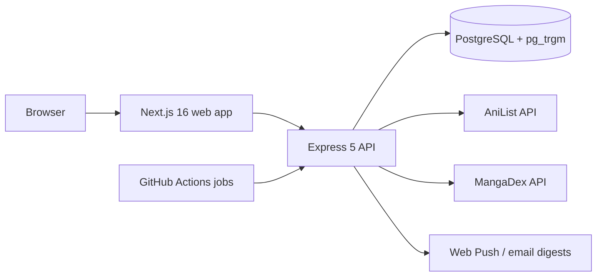

<!-- ============================== HEADER ============================== -->
<p align="center">
  
</p>

<p align="center">
  
</p>

<p align="center">
  <a href="https://www.linkedin.com/in/shamit-reddy-347438380/"></a>
  <a href="mailto:reddyshamit@gmail.com"></a>
  <a href="https://github.com/shamit64?tab=repositories"></a>
</p>

<br/>

<!-- ============================== ABOUT ============================== -->

## 👋 Hi, I'm Shamit

I'm a B.Tech Information Technology student at **Mahatma Gandhi Institute of Technology**, Hyderabad (class of **2027**). I like knowing how a system works under the hood, and I write software as if it were going to production: validated input, real database constraints, and tests that run against a real database rather than mocks.

- 🔭 **Building:** [RepoRescue](https://github.com/shamit64/RepoRescue), a zero-dependency CLI that grades a repository's health
- 🌱 **Learning:** PostgreSQL performance, API design and cloud deployment
- 🧩 **Interested in:** computer networks and cloud systems
- 💼 **Looking for:** software engineering internships (backend / full-stack)

<br/>

<!-- ============================== FLAGSHIP ============================== -->

## 🚀 Featured projects

### 📚 [MangaForEver](https://github.com/shamit64/Manga-Platform-MangaForEver)

**A full-stack platform for discovering, tracking and reviewing manga, manhwa and manhua, backed by a real catalog imported from AniList.**

<a href="https://github.com/shamit64/Manga-Platform-MangaForEver">
  
</a>

<p>
  
  
  
  
  
  
  
</p>

| | |
|---|---|
| 🔎 **Search that forgives typos** | PostgreSQL full-text ranking plus `pg_trgm` trigram matching on GIN indexes, so "berzerk" still finds *Berserk* |
| 🧠 **Explainable recommendations** | Content-based scoring with diversity re-ranking; every pick says why it's there ("Because you read…") |
| ⏱️ **Catalog that keeps itself current** | Scheduled jobs on GitHub Actions pick up new chapters every 15 minutes, with a live updates feed, Web Push and email digests |
| 🛡️ **Production habits** | Zod validation, Helmet, rate limiting, OpenAPI 3.1 docs, database-level integrity constraints and an admin audit log |
| 🧪 **Tested for real** | 92 Vitest + Supertest integration and unit tests running against a real PostgreSQL database |

<details>
<summary><b>How it fits together</b></summary>
<br/>



</details>

<br/>

### 🩺 [RepoRescue](https://github.com/shamit64/RepoRescue)

**A local-first health check for your repositories: no network requests, no account, no runtime dependencies.**

<p>
  
  
  
  
</p>

```text
$ reporescue scan .
[docs]  62.5/100
  FAIL  License: No LICENSE file. Others cannot legally reuse the code.
[git]   100/100
[code]  100/100
[deps]  not scored

Overall score: 87.5/100  (grade B)
Top fixes:
   1. [FAIL] License: Add a LICENSE file (choosealicense.com helps pick one)
```

- **14 checks** across docs, git hygiene, code (tests, large files, committed secrets) and dependency pinning
- Every warning or failure comes with a **suggested fix**, ranked so the most useful ones come first
- Reports as **text, JSON, Markdown or a single-file HTML** page with no scripts or external assets
- `--fail-under` turns it into a **CI gate** that fails the build when repo health drops

<br/>

### 🧰 More projects

<table>
<tr>
<td width="50%" valign="top">

#### ☁️ [Cloud File Storage](https://github.com/shamit64/CloudFileStorage)

*A small self-hosted file store with a web dashboard*


- Flask REST endpoints to upload, list, download, search and delete files
- Dashboard with drag-and-drop upload, file sizes and upload times

</td>
<td width="50%" valign="top">

#### 🔌 [Ethernet Switch Simulator](https://github.com/shamit64/Basic-Ethernet-Switch-Simulator)

*How a real switch decides where each frame goes*


- Learns which MAC address lives on which of its 4 ports
- Forwards known frames, floods unknown and broadcast ones, drops same-port traffic
- Interactive CLI to send frames and inspect the MAC table

</td>
</tr>
</table>

<!-- Add this back once Job Recruitment Portal has code and a README:

#### 💼 [Job Recruitment Portal](https://github.com/shamit64/Job-Recruitment-Portal)

A portal where recruiters post jobs and candidates apply and track their applications.

- KEY FEATURE
- KEY FEATURE

-->

<br/>

<!-- ============================== TECH ============================== -->

## 🛠️ Tech stack

<table align="center">
  <tr>
    <td align="right"><b>Languages</b></td>
    <td></td>
  </tr>
  <tr>
    <td align="right"><b>Backend</b></td>
    <td></td>
  </tr>
  <tr>
    <td align="right"><b>Frontend</b></td>
    <td></td>
  </tr>
  <tr>
    <td align="right"><b>Data</b></td>
    <td></td>
  </tr>
  <tr>
    <td align="right"><b>Tools &amp; DevOps</b></td>
    <td></td>
  </tr>
</table>

<br/>

<!-- ============================== FOOTER ============================== -->

<p align="center">
  <b>Hiring for an internship, or want to build something together?</b><br/>
  <a href="https://www.linkedin.com/in/shamit-reddy-347438380/">Message me on LinkedIn</a> or <a href="mailto:reddyshamit@gmail.com">send me an email</a>.
</p>

<p align="center">
  
</p>
